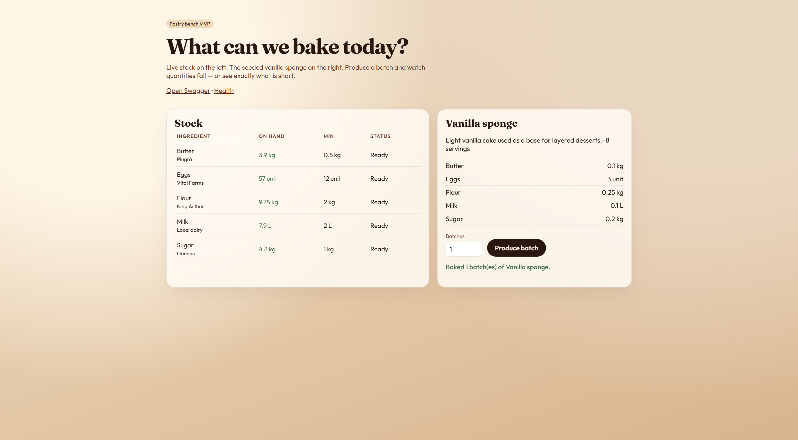
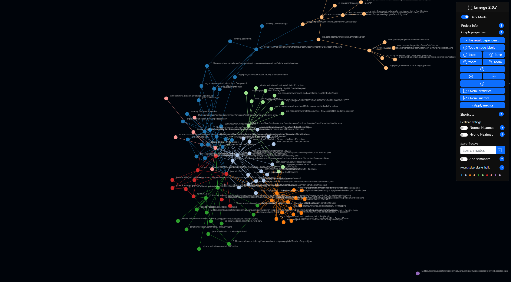
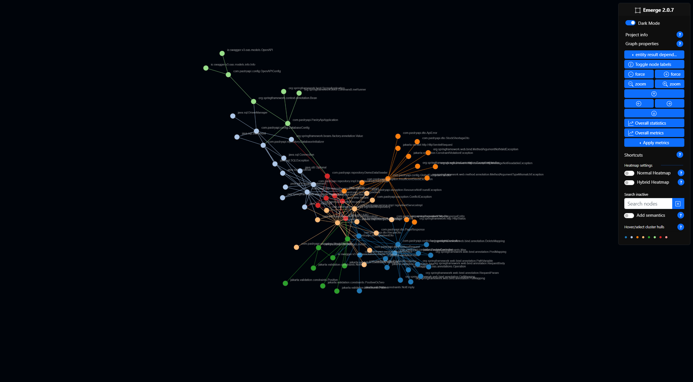

# Pastry API

REST API for a pastry shop: keep ingredient stock, define recipes, and produce batches when there is enough inventory. Built for the "Analisis y desarrollo de Software" course.

## Description

The API covers the MVP loop:

1. Register ingredients with unit, on-hand quantity, and a low-stock threshold.
2. Compose recipes from those ingredients.
3. Produce a batch: stock is consumed, or the API returns **409** listing what is short.

Demo data (a vanilla sponge and five ingredients) is seeded on first run.

## Technologies

- Java 25
- Spring Boot 4.1.1
- Maven
- SQLite
- Lombok 1.18.48
- SpringDoc OpenAPI 3.1.1 (Swagger)
- Docker

## How to run the project

1. Clone the repository.
2. Run with Maven (JDK 25):
    ```bash
    ./mvnw spring-boot:run
    ```
    On Windows:
    ```bash
    .\mvnw.cmd spring-boot:run
    ```

The application starts on port 8080.

## Run with Docker

```bash
docker compose up --build
```

SQLite lives in the `/data` volume so stock survives restarts.

## Try it

| Surface | URL |
| --- | --- |
| Pastry bench UI | [http://localhost:8080/](http://localhost:8080/) |
| Swagger UI | [http://localhost:8080/swagger-ui.html](http://localhost:8080/swagger-ui.html) |
| Health | [http://localhost:8080/actuator/health](http://localhost:8080/actuator/health) |

Useful API routes:

- `GET /api/ingredients?name=&status=&lowStock=&page=&size=`
- `POST /api/recipes`
- `POST /api/recipes/{id}/produce` with `{ "batches": 1 }`



## Features

Must-have MVP (implemented):

- [x] Ingredient stock fields (`unit`, `quantity`, `minimumQuantity`) and input validation
- [x] Recipe CRUD with ingredient lines
- [x] Produce a recipe: verify stock, consume quantities, or return 409 if short
- [x] List filters (name, availability, low stock) and pagination
- [x] Consistent JSON errors (400 / 404 / 409) and a health endpoint
- [x] Seed data so Swagger and the bench UI have a demo recipe
- [x] Automated tests for CRUD, validation, and the produce flow
- [x] Minimal UI to list stock and trigger Produce

Nice to have later:

- [ ] Authentication
- [ ] Orders, customers, and suppliers
- [ ] Cost reports

Scope notes: [`docs/files/mvp.md`](docs/files/mvp.md).

## Architecture screenshots

Generated with [Emerge](https://github.com/glato/emerge) (`emerge-viz`). Captures live in [`docs/screenshots/`](docs/screenshots/).



File-level dependency graph of the Java sources.



Entity dependency graph (controllers, services, repositories, and supporting types).

Regenerate the interactive app from the repository root (create `docs/emerge-export` first):

```bash
pip install emerge-viz setuptools==75.8.2
mkdir docs/emerge-export
emerge --config docs/emerge.yaml
```

Then open `docs/emerge-export/html/emerge.html` in a browser. Emerge 2.0.7 exports NetworkX `edges`; if the canvas stays blank, map `graph.edges` to `graph.links` in the console before the force layout starts.

Why Emerge for this repo:

| Tool | Fit |
| --- | --- |
| CodeLandscapeViewer | Deep analysis is Python / JS / TS. Java is only generic file-level. |
| CodeVisualizer (VS Code) | Java works for function flowcharts, not for the architecture/import graph. |
| code2flow | Call graphs for Python, JavaScript, Ruby, and PHP. No Java. |
| **Emerge** | Native Java file + entity graphs in the browser. |

## Course Information

This project was developed as part of the "Analisis y desarrollo de Software" course. It is a practical example of a Spring Boot REST API, OpenAPI docs, Docker, and a small pastry-shop MVP.
